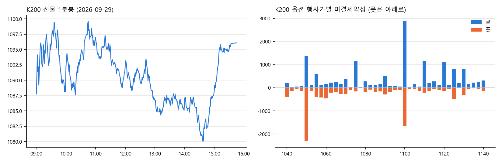
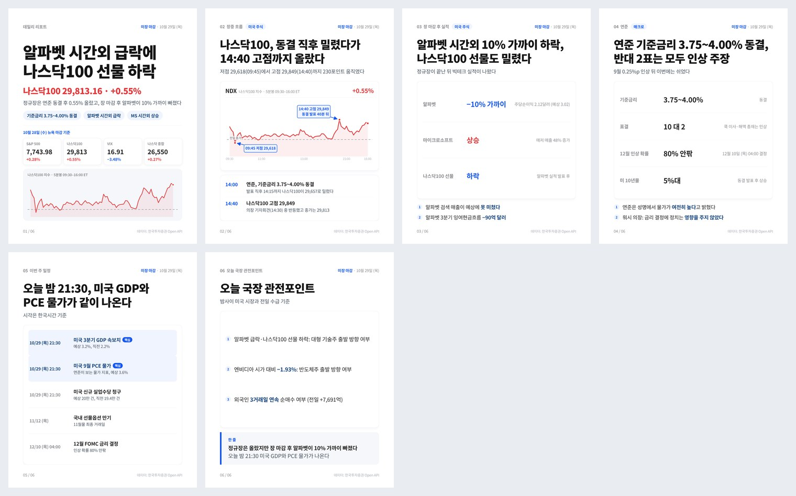
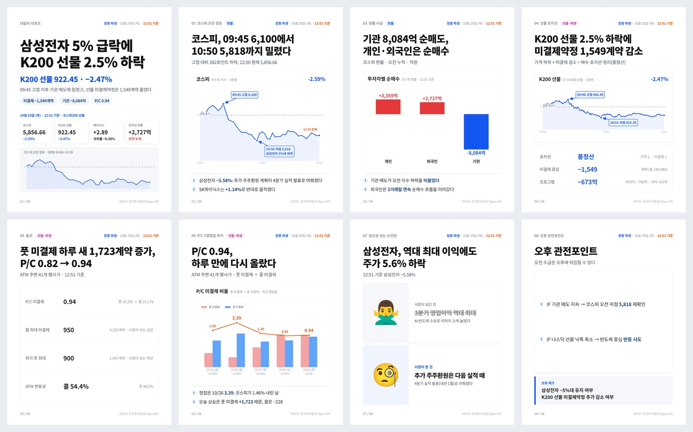
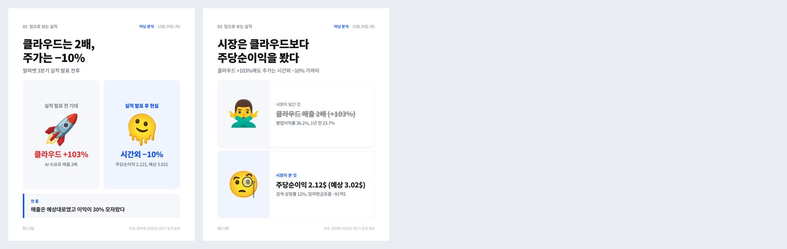

# winwin_macro — 시장 데이터 수집과 카드뉴스 자동화

한국투자증권(KIS) Open API로 국내 파생·수급 데이터와 미국 지수·종목 데이터를 평일마다 수집하고, 그 데이터로 인스타그램 [@winwin_macro](https://www.instagram.com/winwin_macro)에 하루 세 번 시장 카드뉴스를 자동으로 만들어 올립니다.

> 수집한 원본 데이터는 KIS Open API 이용 조건에 따라 **비공개 저장소**에만 보관합니다. 이 저장소에는 코드, 카드 제작 키트, 발행된 카드 이미지만 있습니다.



## 하루 흐름

| 한국시간 | 하는 일 | 발행 |
|---|---|---|
| 화~토 06:58 → 07:05 | 미국 지수 5분봉·종목 1분봉 수집 → 미장 마감 카드 제작 | 08:00 |
| 평일 12:50 → 12:57 | K200 선물·옵션, 현물 수급 수집 → 장중 파생 카드 제작 | 13:30 |
| 평일 15:48, 16:03 → 16:06 | 코스피 분봉, 투자자·프로그램 수급, 섹터 대장주 수집 → 국장 마감 카드 제작 | 16:30 |

정해진 시각에 예약 작업이 GitHub Actions 워크플로를 `workflow_dispatch`로 실행합니다. GitHub의 `schedule`은 실제로 5~9시간씩 밀려서(12:55 예약이 18~19시에 실행) 쓰지 않습니다.

## 카드 예시

| 미장 마감 | 장중 파생 | 밈 카드 |
|---|---|---|
|  |  |  |

## 수집 항목

| 구분 | 항목 | API |
|---|---|---|
| K200 선물 | 현재가, 1분봉(정규장 전체), 베이시스, 이론가, 미결제약정 | `FHMIF10000000`, `FHKIF03020200` |
| K200 옵션 | ATM ±20 행사가 콜·풋의 IV, 델타·감마·베가·세타, 미결제약정 → P/C 비율, 최대 미결제 행사가, ATM IV | `FHPIF05030100` |
| 선물 포지션 | 가격 방향과 미결제 증감으로 신규매수, 숏커버, 신규매도, 롱청산 구분 | |
| 수급 | 투자자별 순매수, 프로그램매매(차익·비차익), 투자자별 프로그램매매 | 국내주식 시세 API |
| 미국 | 지수 5분봉, ETF·종목 1분봉 | `FHKST03030200`, `HHDFS76950200` |

## 수집하면서 해결한 문제

| 문제 | 해결 |
|---|---|
| 옵션 시세가 한 번에 100개까지만 와서, 행사가가 많은 날은 등가격 근처가 빠짐 | 등가격 주변 행사가를 골라 하나씩 따로 조회 |
| 해외 종목 분봉이 한 번에 120개, 최신→과거 순으로만 옴 | 이전 페이지의 가장 오래된 봉 1분 전으로 옮겨가며 09:30까지 거슬러 올라감 |
| 지수 분봉은 페이징이 없어 최근 102봉만 옴 | 5분봉으로 받아 정규장(390분 = 78봉)을 한 번에 덮음 |
| 문서 예제대로 요청하면 오류가 나는 API가 있음 | 필요한 입력값을 직접 시험해 찾아냄 |
| 투자자별 매매 동향이 부호가 반대로 나오는 경우가 있음 | 네이버 금융 수치와 대조해 맞는 API만 사용 |
| 실행할 때마다 접근 토큰을 새로 받으면 발급 제한(1분 1회)에 걸림 | 토큰을 캐시해 하루 1번만 발급 |
| 선물 근월물 종목코드가 만기마다 바뀜 | 만기일(둘째 목요일)을 계산하고 종목 마스터에서 자동으로 찾아 저장 |
| 16:00 이후 수집한 투자자 수급은 시간외 거래가 더해져 부호까지 뒤집힘 | 웹 마감 시황과 대조하고, 어긋나면 16:10 이전 수집본으로 다시 대조 |
| GitHub Actions 예약 실행이 몇 시간씩 밀림 | 외부 예약 작업이 정시에 `workflow_dispatch`로 실행 |

## 카드 제작 키트 (`cards/`)

- **데이터 → 수치**: 시가·고가·저가·종가·등락률·고점/저점 시각은 전부 수집 JSON에서 계산합니다(`kit.py facts`). 기사는 "왜 움직였나"만 담당합니다.
- **디자인 고정**: 차트(matplotlib)와 카드(HTML → Playwright 스크린샷)를 코드로 고정해 매일 같은 디자인이 나옵니다. 차트는 1차 렌더에서 자리 크기를 재고, 그 크기로 다시 그려 빈 공간 없이 채웁니다.
- **자동 검사**: 렌더 후 글자 넘침, 박스 잘림, 제목 3줄, 표 칸 넘침을 찾아 경고합니다.
- **카드 종류**: 표지, 장중 경로, 투자자 막대, 대장주 가로 막대, 점 연결(금리·확률), 키값, 일정 표, 섹터, P/C 5영업일 추이, 밈(이모지), 스토리(1080×1920).
- **문장 규칙**: 비유 없이 대상과 숫자를 넣어 직접 씁니다. 매체명·인용 표현은 쓰지 않습니다(`cards/RUNBOOK.md`).

```
scripts/      KIS API 수집 (kis.py: 토큰 발급·캐시, 키는 환경변수)
workflows/    수집 워크플로 (비공개 저장소에서 실행되는 것과 같은 파일)
cards/        카드 제작 키트 (kit.py, render.js, story.py, publish.sh, RUNBOOK.md)
posts/        발행된 카드 이미지
```

## 실행

1. KIS Developers에서 앱키·앱시크릿 발급
2. 저장소 Settings → Secrets and variables → Actions에 `KIS_APP_KEY`, `KIS_APP_SECRET` 등록 (코드·파일에는 키를 넣지 않음)
3. `workflows/`의 파일을 `.github/workflows/`에 두고 Actions 탭에서 Run workflow로 실행

```bash
pip install -r requirements.txt
KIS_APP_KEY=... KIS_APP_SECRET=... PYTHONPATH=scripts python scripts/collect_kr.py
bash cards/setup.sh && python3 cards/kit.py build cards/examples/us.json
```
